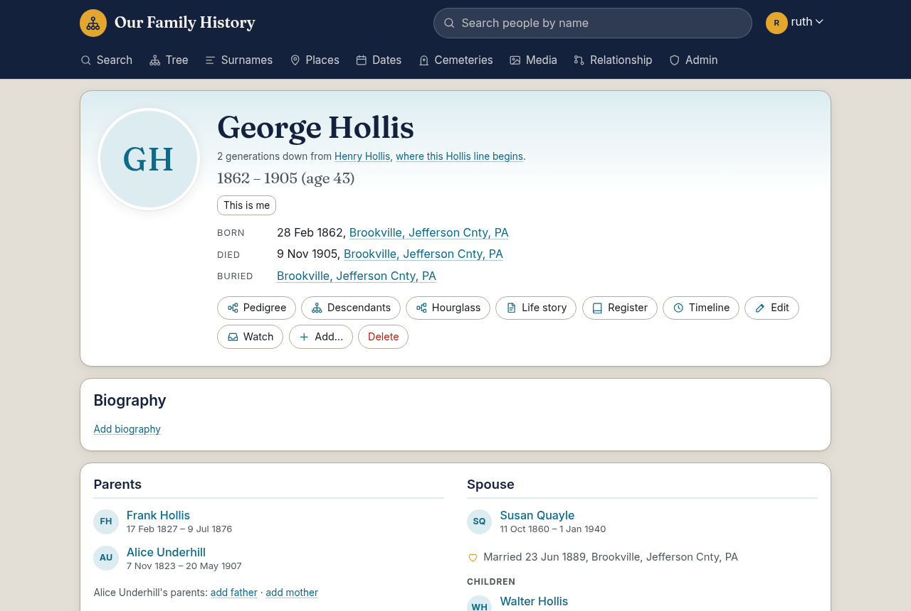
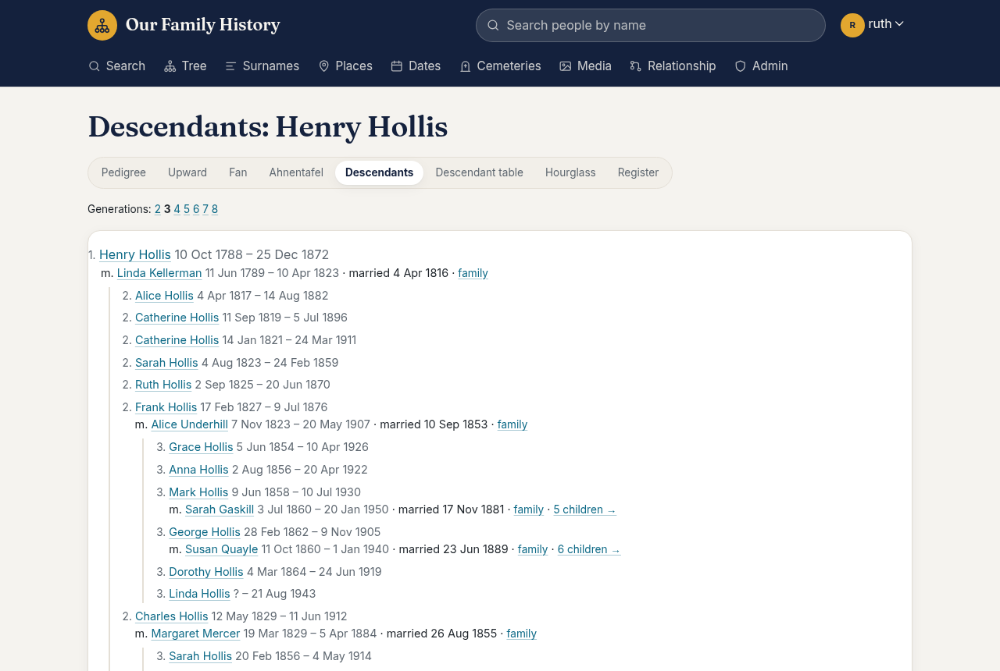
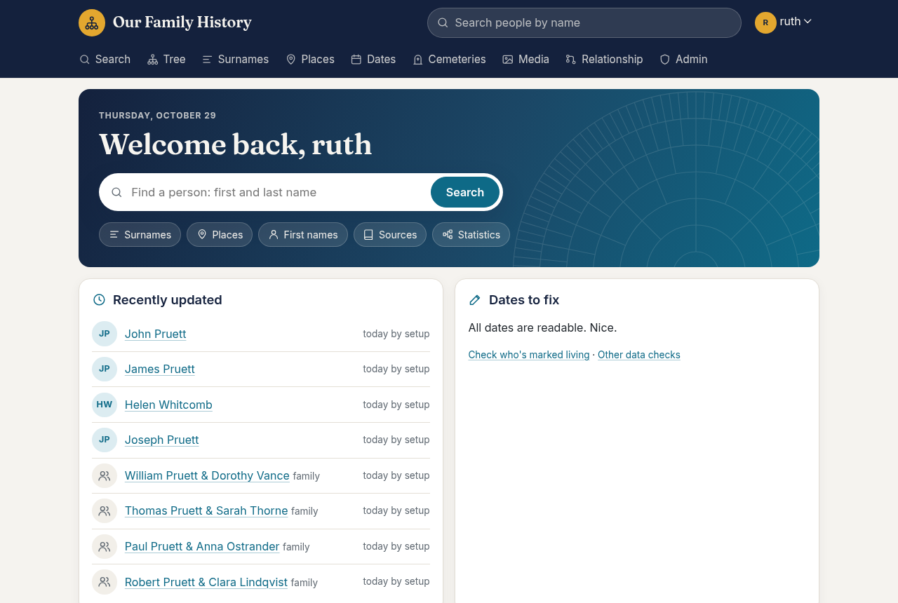
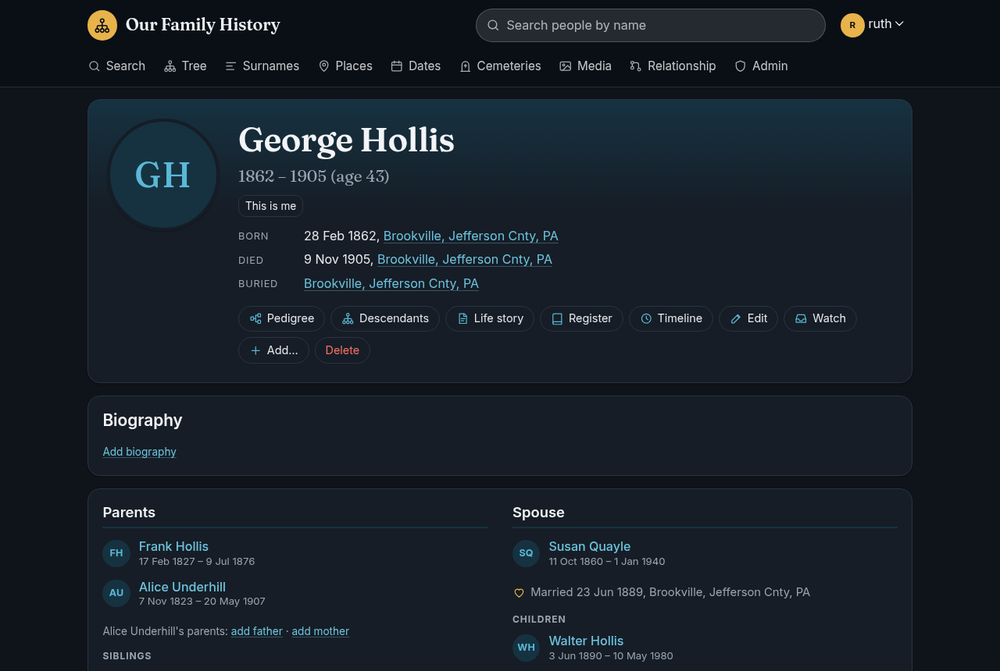
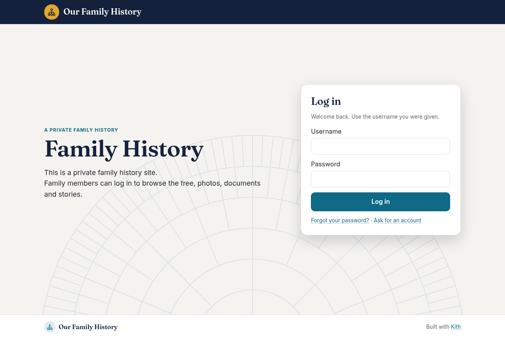
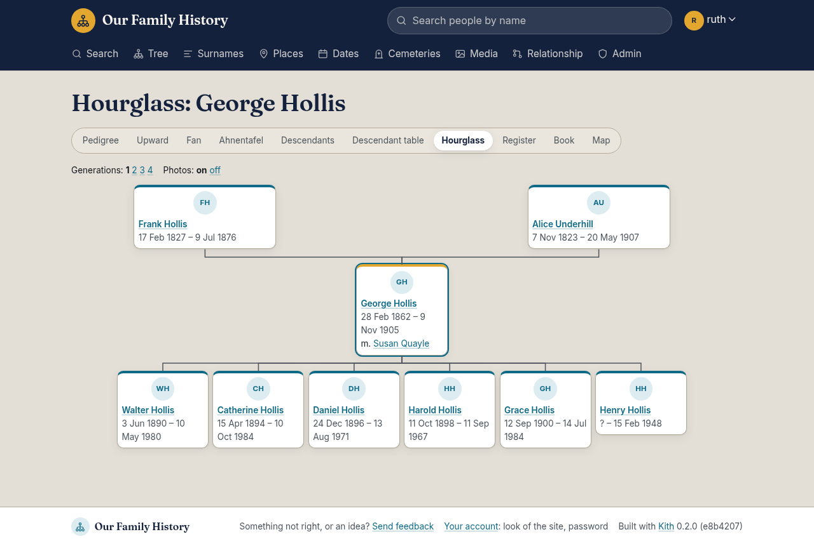
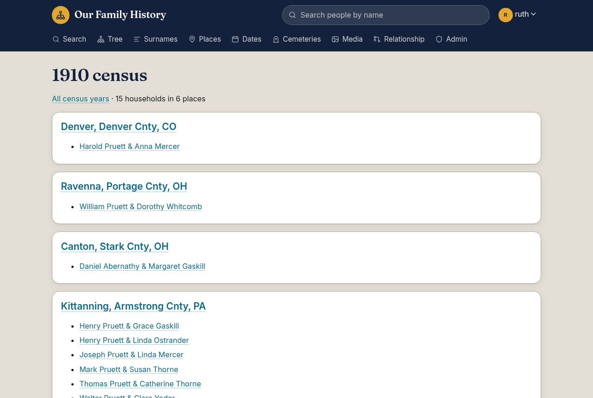
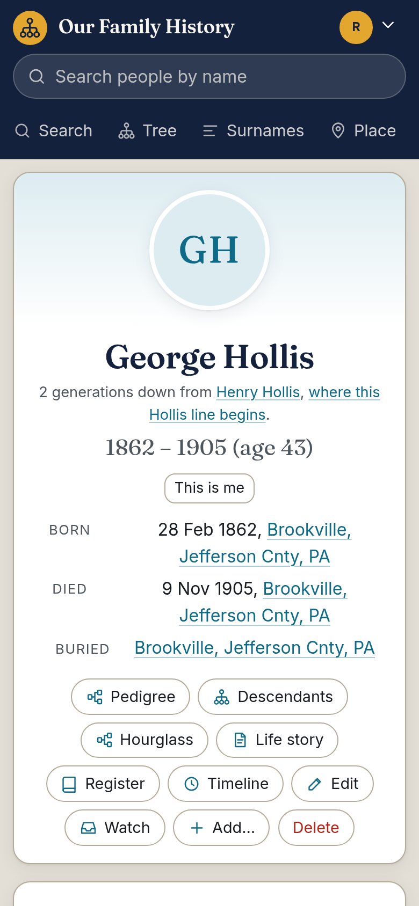

# Kith

A private family history website for your relatives: people, families, photos, documents and stories, with
living people kept private. Free and open source (AGPL), written in Python/Flask on MariaDB.

Website: https://kithgenealogy.org

Kith is a "here's the code" project. It runs a real family's site every day. Pull requests are welcome, but there
are no support promises.

Kith is built by a veteran, retired IT professional working with AI (Anthropic's Claude). Much of the code is
AI-written; a person decides what gets built, and reviews and tests every change, and the test suite covers every
line.

| | |
|---|---|
|  |  |
|  |  |
|  |  |

The screenshots show the made-up sample family that comes with Kith.

## What it does

- Person and family pages with life events, sources and citations (with scans of the record), notes, a life
  story, a map of where a life happened (a line through the places, in the order of the events), a woman's
  married names, and links that search FamilySearch, Find a
  Grave, Ancestry and newspapers (Chronicling America, Newspapers.com) for the person.
- Charts: ancestors, descendants, hourglass and a fan chart with photos that prints as a poster. The Tree menu
  opens an hourglass of you, or of a starting person an admin picks. The relationship page shows the path between
  two people as a row of faces.
- A branch book (the life stories of a person's descendants, to print), a family map (where a surname's people
  or a person's descendants were born and died), and "Where the lines begin" (the earliest person of each
  surname).
- Census by year: each census year's households, by place. Census matches suggests which person in the tree
  each name typed in a census transcription is, and can fill in a birth year from the age; an editor says yes.
- Places drill down from state to county to town, with everyone in an area on one list.
- Photos and documents, with faces tagged to people, comments, and PDF thumbnails.
- Search by name (including married names and spelling variants), by family, and by place.
- Privacy: living people are hidden from those who may not see them. Accounts have roles, and relatives can ask
  for an account and say "this is me".
- Editing on the site: add relatives, merge duplicates, tidy place names (spellings, misspellings, record titles
  where a place should be), link surname spellings, and data checks for impossible dates and death dates that
  differ from the obituary.
- GEDCOM import (with undo) and export.
- What's new, watching a person, and an optional weekly email.
- Admin page with what's waiting, recent visits, and what's changed on the site lately (from its git history).
- Five themes, which each person can choose for themselves, including large print.

## Install

You need a server that your family can reach. Kith listens on port 8000. Put it behind a reverse proxy with
HTTPS before it's on the internet (see "Settings"). Three ways, best first:

| | Proxmox VE | Docker | Debian by hand |
|---|---|---|---|
| You need | Proxmox VE 8 or 9 | Docker with Compose v2, and git | Debian 13 (or Debian-like, Python 3.12+), root |
| Installs | One command | Six commands | About 20 commands |
| Updates | One command, saves a database copy first | Three commands | About 10 commands |
| Nightly backups, Admin > Backups page | Yes | No: back up the Docker volumes yourself | Optional, by hand |
| Scheduled jobs (place coordinates, weekly email, version check) | Yes | Add three lines to the host's crontab | Yes |

If you have Proxmox, use it: one command sets up everything, including backups and updates. Kith needs about
1 GB of memory and a few GB of disk plus your photos. It brings its own MariaDB in all three.

### Proxmox VE

On the Proxmox host's shell:

    bash -c "$(curl -fsSL https://raw.githubusercontent.com/dreed47/kith/main/ct/kith.sh)"

This makes a Debian 13 container (2 cores, 1 GB memory, 8 GB disk; it asks if you want others) with Kith, MariaDB
and the first admin account. It uses the [community-scripts](https://community-scripts.github.io/ProxmoxVE/)
engine. The admin login is in the container: `cat ~/kith.creds`.

**Update:** in the container's shell, type `update`. It saves a copy of the database in `/var/backups/kith`, then
installs the newest release.

### Docker

    git clone https://github.com/dreed47/kith.git
    cd kith/docker
    git checkout "$(git tag --sort=-v:refname | head -1)"   # the newest release
    cp example.env .env          # then set DB_PASSWORD in .env
    docker compose up -d
    docker compose exec app flask --app app setup db       # the first admin (it asks for a password)
    docker compose exec app flask --app app setup sample   # optional: a made-up family to try it with

Then open http://localhost:8000. The database, photos and settings are in the Docker volumes `kith_db`,
`kith_media` and `kith_instance`; back those up.

**Update:** in `kith/docker`:

    git fetch --tags
    git checkout "$(git tag --sort=-v:refname | head -1)"
    docker compose up -d --build

Database upgrades run as the site starts.

**Scheduled jobs:** Docker doesn't run them by itself. Add these to the host's crontab (`crontab -e`), with your
path to `kith/docker`:

    30 2 * * *  cd /path/to/kith/docker && docker compose exec -T app flask --app app geocode run
    0 13 * * 1  cd /path/to/kith/docker && docker compose exec -T app flask --app app digest send
    0 4 * * *   cd /path/to/kith/docker && docker compose exec -T app flask --app app updates check

Place coordinates nightly, the weekly email (needs email set up; sends nothing until an admin turns it on) and the
daily version check
(see "What leaves your server").

### Debian by hand

On Debian 13 (or another Debian-like server with Python 3.12 or newer), as root. These are the Proxmox
installer's steps, by hand:

    apt update && apt install -y mariadb-server python3-venv poppler-utils rsync curl openssl

    # The database, with a random password
    DB_PASS=$(openssl rand -hex 16)
    mariadb -e "CREATE DATABASE kith CHARACTER SET utf8mb4 COLLATE utf8mb4_unicode_ci;
      CREATE USER 'kith'@'localhost' IDENTIFIED BY '$DB_PASS'; GRANT ALL ON kith.* TO 'kith'@'localhost';"

    # The newest release, in /opt/kith
    URL=$(curl -fsSL https://api.github.com/repos/dreed47/kith/releases/latest | python3 -c 'import json,sys; print(json.load(sys.stdin)["tarball_url"])')
    mkdir -p /opt/kith && curl -fsSL "$URL" | tar -xz --strip-components=1 -C /opt/kith
    python3 -m venv /opt/kith/.venv
    /opt/kith/.venv/bin/pip install -q -r /opt/kith/deploy/requirements.txt gunicorn==23.0.0

    # A user for the site, its folders, and its settings (readable only by root)
    useradd --system --home-dir /var/lib/kith --shell /usr/sbin/nologin kith
    install -d -o kith -g kith -m 750 /var/lib/kith /srv/kith /srv/kith/media
    install -m 600 /dev/null /etc/kith.env
    cat >/etc/kith.env <<EOF
    KITH_DB_HOST=127.0.0.1
    KITH_DB_PORT=3306
    KITH_DB_NAME=kith
    KITH_DB_USER=kith
    KITH_DB_PASSWORD=$DB_PASS
    KITH_MEDIA_ROOT=/srv/kith/media
    KITH_INSTANCE=/var/lib/kith
    KITH_STRONG_PASSWORDS=1
    EOF

    # The tables and the first admin (it asks for a password)
    systemd-run --quiet --wait --pty --uid=kith --gid=kith --working-directory=/opt/kith \
      -p EnvironmentFile=/etc/kith.env /opt/kith/.venv/bin/flask --app app setup db --admin admin

    # The service, on port 8000
    cat >/etc/systemd/system/kith.service <<'EOF'
    [Unit]
    Description=Kith family history site
    After=network.target mariadb.service
    Requires=mariadb.service

    [Service]
    User=kith
    Group=kith
    WorkingDirectory=/opt/kith
    EnvironmentFile=/etc/kith.env
    ExecStartPre=/opt/kith/.venv/bin/flask --app app setup upgrade
    ExecStart=/opt/kith/.venv/bin/gunicorn --workers 3 --bind 0.0.0.0:8000 --access-logfile - "app:create_app()"
    Restart=on-failure
    ProtectSystem=strict
    ReadWritePaths=/var/lib/kith /srv/kith
    PrivateTmp=true
    NoNewPrivileges=true

    [Install]
    WantedBy=multi-user.target
    EOF
    systemctl daemon-reload && systemctl enable --now kith

    # Nightly place coordinates, the weekly email (off until turned on) and the daily version check
    bash /opt/kith/deploy/jobs.sh

Then open http://your-server:8000 and log in as `admin`. To add the made-up sample family:
`systemd-run --wait --pty --uid=kith --working-directory=/opt/kith -p EnvironmentFile=/etc/kith.env
/opt/kith/.venv/bin/flask --app app setup sample`. For nightly backups and the Admin > Backups page, also do the
"Setting up Backups" part of `install/kith-install.sh`.

**Update:** as root:

    systemctl stop kith
    mkdir -p /var/backups/kith
    mariadb-dump --single-transaction kith | gzip >"/var/backups/kith/kith-$(date +%Y%m%d-%H%M%S).sql.gz"
    URL=$(curl -fsSL https://api.github.com/repos/dreed47/kith/releases/latest | python3 -c 'import json,sys; print(json.load(sys.stdin)["tarball_url"])')
    rm -rf /opt/kith && mkdir -p /opt/kith && curl -fsSL "$URL" | tar -xz --strip-components=1 -C /opt/kith
    python3 -m venv /opt/kith/.venv
    /opt/kith/.venv/bin/pip install -q -r /opt/kith/deploy/requirements.txt gunicorn==23.0.0
    bash /opt/kith/deploy/jobs.sh
    systemctl start kith

Photos, settings and the database live outside `/opt/kith`, so this only replaces the code. Database upgrades run
as the site starts.

## Your tree

Import a GEDCOM file from your genealogy program under Admin > Import GEDCOM. Photos and documents are uploaded
on the site. A GEDCOM file names them, but doesn't carry them.

## Settings

Settings are environment variables (`/etc/kith.env`, or `docker/.env`):

| Variable | What it does |
|---|---|
| `KITH_SECURE_COOKIES=1` | Send the login cookie over HTTPS only. Set it once you are behind HTTPS. |
| `KITH_TRUSTED_PROXIES=1` | Behind a reverse proxy, so login throttling sees real visitors' addresses. |
| `KITH_SITE_URL` | The site's address (`https://tree.example.org`), for links in email. |
| `KITH_SMTP_HOST`, `_PORT`, `_USER`, `_PASSWORD`, `KITH_MAIL_FROM` | Outgoing email: account confirmations, password resets, invitations. Off until `KITH_SMTP_USER` is set. |
| `KITH_THEME` | The site's theme (default `default`). |
| `KITH_MAX_UPLOAD_MB` | Largest upload (default 50). |
| `KITH_UPDATE_CHECK=0` | Never check for new versions (see "What leaves your server"). |

The site title, tagline, welcome page text, banner picture, where the Tree page starts for people not linked
to their own record, and the version check are set under Admin > Site settings.

Three scheduled jobs. The Proxmox installer sets them up as systemd timers (`deploy/jobs.sh`); elsewhere run them
from cron:

- `flask --app app geocode run`: looks up map coordinates for places that have none (OpenStreetMap's Nominatim,
  one a second). Only place names leave the server.
- `flask --app app digest send`: the weekly email, once an admin turns it on.
- `flask --app app updates check`: daily, asks kithgenealogy.org whether a newer Kith is out (see "What leaves
  your server").

Back up the database (`mariadb-dump`) and the photos folder. On Proxmox, the container's own backups cover both.

## What leaves your server

Kith has no ads, trackers or analytics, and nothing about your tree goes anywhere unless you set it up. These are
all the connections it makes, and how to stop each one:

- **Version check** (on by default). Once a day the site asks kithgenealogy.org for the newest version, and Admin
  says when there's one. It sends a random ID made for this site and its version number (`{"site":
  "4f1c…", "version": "0.2.0"}`), nothing else: no names, no address, no tree data. The Kith project counts
  running sites from it, keeping only the ID, the version and the first and last days it asked (`worker/`). The
  first check is the morning after install. To turn it off, any of:
  - Admin > Site settings > Updates: untick **Check for new versions of Kith**, then Save.
  - `KITH_UPDATE_CHECK=0` in `/etc/kith.env` (or `docker/.env`), then restart: off for good, whatever Site
    settings say.
  - Proxmox: `systemctl disable --now kith-updates.timer`. Elsewhere: leave out its cron line.
- **Map coordinates.** The nightly geocode job sends place names only (no people) to OpenStreetMap's Nominatim.
  Stop it: `systemctl disable --now kith-geocode.timer`, or leave out its cron line. Coordinates can still be typed
  in by hand.
- **Map pictures.** Pages with a map have each visitor's browser load the map tiles from OpenStreetMap, which sees
  that visitor's address, as any website does. Pages without maps don't.
- **Email** goes only through the SMTP server you set (`KITH_SMTP_*`), and only once you set one.
- **Feedback reports** are copied to a GitHub repository's issues only when `KITH_GITHUB_REPO` and
  `KITH_GITHUB_TOKEN` are set.
- **Search links** on person pages (FamilySearch, Find a Grave, Ancestry, newspapers) are plain links: nothing is
  sent until someone clicks one.

Fonts, icons and scripts are all served by the site itself.

## Themes

A theme is `themes/<name>/`:

- `theme.css` (required): the CSS tokens (`--bg`, `--text`, `--font-body`, ...), light and dark.
- `theme.toml`: the default site title and welcome text. `name`, `description` and `swatches` label it on the
  account page.
- `templates/` (optional): overrides any template in `app/templates/`. Extend the default with
  ``.
- `static/` (optional): served at `/theme/static/...`.

Each person can pick a theme for themselves under Your account. Only its `theme.css` applies then. Fonts are
bundled in `app/static/fonts/` (SIL Open Font License). `app/static/app.css` and `app/templates/` use only
`var(--token)`, never literal colors or fonts. `tests/test_themes.py` checks this.

## Development

    docker compose up -d db                  # MariaDB for development and tests, on port 3307
    uv run pytest                            # every line and branch of app/ must be covered
    uv run flask --app app setup db          # once: tables and an admin in the dev database
    uv run flask --app app setup sample      # optional: the made-up family
    uv run flask --app app run               # http://127.0.0.1:5000

The tests build `kith_test` from an empty database (`app/schema.sql` plus `app/migrations`) and the made-up
sample family (`app/sample.ged`, made by `scripts/make_sample_gedcom.py`). A database change is a new numbered
file in `app/migrations/`. It runs once on every site at its next start, so it must be safe to run twice.

The landing page at kithgenealogy.org is `site/`, published by `.github/workflows/pages.yml`. Its tour video is
recorded by `scripts/tour/record.sh` (needs Playwright, Chromium and ffmpeg; see the script's header).

See `CONTRIBUTING.md`.

## License

AGPL-3.0. If you run a changed version for others, offer them its source. See `LICENSE`.
